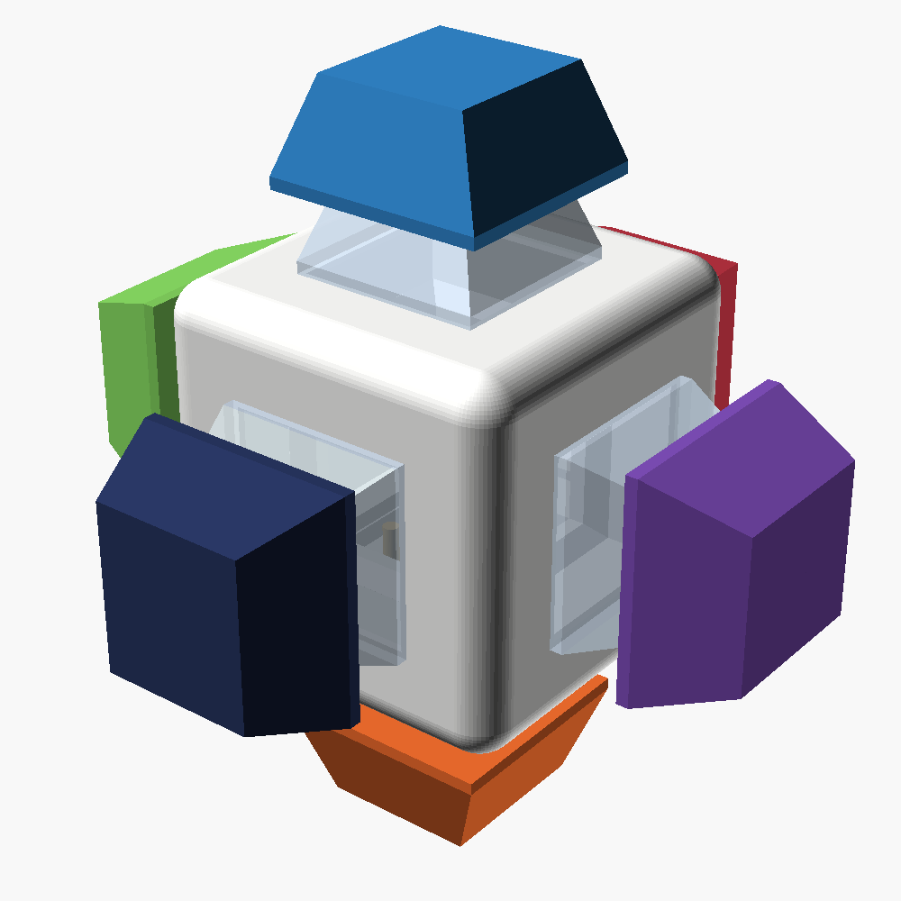
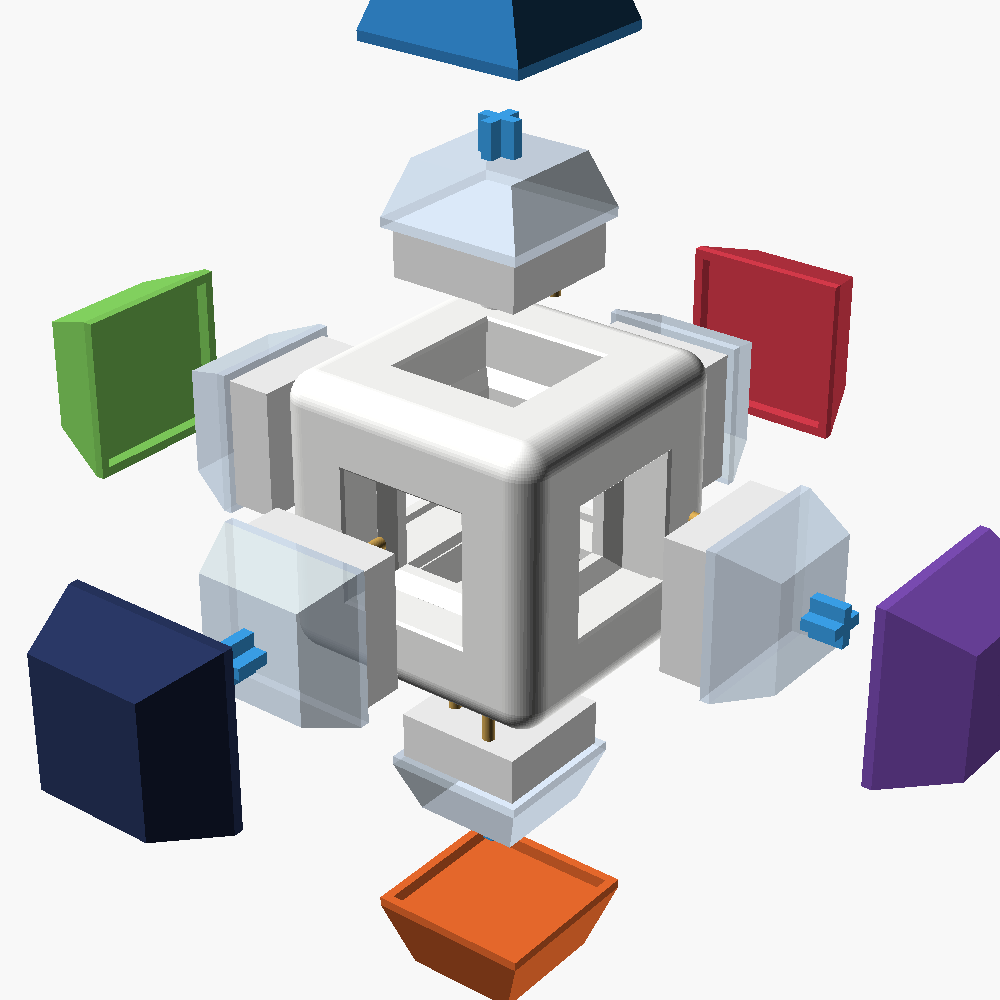
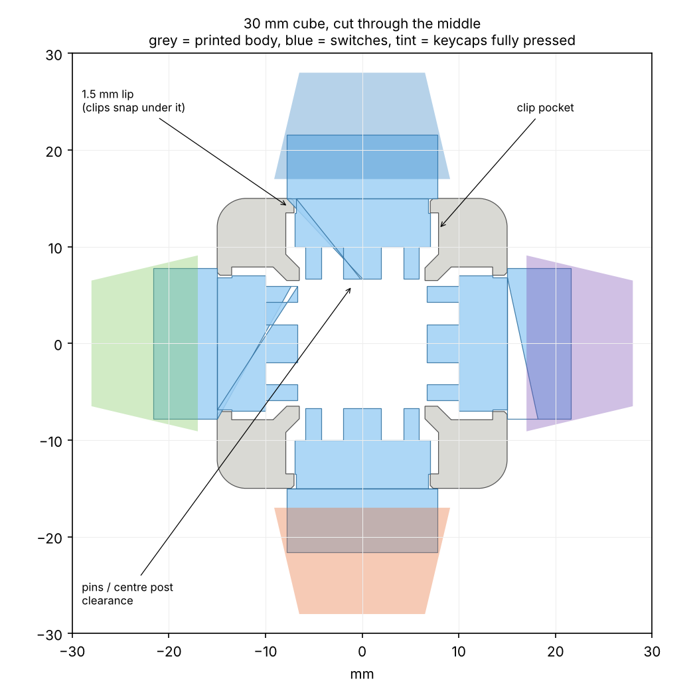

# Keyboard Switch Fidget Cube

A 30 mm cube with a mechanical keyboard switch and keycap on every face, purely as a fidget toy (no electronics).
It prints as **one piece, with no supports**. You push six switches in from the outside and press keycaps on.

| Assembled | Exploded | Cut through the middle |
|---|---|---|
|  |  |  |

## Is it possible?

Yes. It's a well-known maker project, and plenty of people have printed one (see [Prior art](#prior-art)).
The only tricky parts are:

1. **The switch holes have to be the right size.** MX switches need a 14.0 mm square hole in a 1.5 mm thick plate.
   Printers make holes slightly differently, so print the small fit-test piece first (see [Printing](#printing)).
2. **The switches have to fit together inside.** Six switches point at the centre, and their pins can hit each other in a small cube.
   That's why some small commercial cubes tell you to cut off pegs and bend pins.
   This design is 30 mm, and a script checks every switch rotation for collisions. Nothing needs trimming (see [Why 30 mm](#why-30-mm)).

## What you need (the parts you don't print)

| Part | Qty | Notes |
|---|---|---|
| MX-style mechanical switches | 6 | Any plate-mount MX-compatible switch: Cherry MX, Gateron, Kailh BOX, Outemu, Akko, etc. 3-pin and 5-pin both work as they are. For fidgeting, pick clicky or tactile ones. The switches in your photos (clear housing, light-blue box stem) look like **Kailh BOX Pale Blue**, a clicky switch. Roughly $3–12 per 10. |
| 1u keycaps with an MX cross stem | 6 | Any profile works (Cherry, OEM, XDA, DSA, SA). Single caps are about $1 each, or buy a cheap blank/colour sampler pack. |
| Keycap + switch puller | 1 | Optional, about $2–14. Only needed to take it apart again. |
| Filament | ~12 g | PLA or PETG. |

**Not compatible:** low-profile Kailh Choc and Gateron LP switches and keycaps, Alps/Matias switches, and Topre. They use different holes and stems.

## Files

| File | What it is |
|---|---|
| `stl/switch_fit_test.stl` | Print this first: a plate and an upright wall with 13.9 / 14.0 / 14.1 / 14.2 mm holes |
| `stl/switch_cube_30mm_hole14.1.stl` | **The cube, default hole size.** Print this one if you skip the fit test. |
| `stl/switch_cube_30mm_hole13.9.stl` … `hole14.2.stl` | The same cube in the other hole sizes, to match your fit-test result |
| `cad/switch_cube.scad` | Parametric OpenSCAD source (size, hole, lip, pockets) |
| `cad/preview.scad` | Stand-in switches and keycaps, used for the pictures |
| `tools/check_fit.py` | Collision check: switches vs. the cube and vs. each other, in every rotation |
| `tools/build.sh` | Rebuilds all STLs and images and runs the check |

## Printing

**Step 1: fit test (strongly recommended).**
Print `stl/switch_fit_test.stl` in the same filament and settings you'll use for the cube.
Push a switch into each hole from the side with the labels or chamfer:

- the **flat row** behaves like the top and bottom faces of the cube,
- the **upright wall** behaves like the four side faces.

Pick the size where the switch goes in with a firm push, **clicks**, and doesn't wobble.
If two sizes feel equally good, take the larger one. Print the cube STL with that hole size.

**Step 2: the cube.**

| Setting | Value |
|---|---|
| Orientation | Any face down (it's symmetric) |
| Supports | **Off.** Everything facing down is a short bridge (≤ 16 mm) or a ledge under 1 mm. |
| Layer height | 0.2 mm is fine. 0.15 or 0.1 mm makes the 1.5 mm clip lips exact; at 0.2 they come out 1.4–1.6 mm, which still holds. |
| Walls / infill | 3 walls, 15–20 % infill |
| Elephant's foot compensation | On, if your slicer has it, so the hole on the bottom face isn't tight |
| Brim | Not needed |

PrusaSlicer's generic profile with supports off gives about **12 g** and 1.5 h. That profile is slow; a modern printer is quicker.

## Assembly

1. Check every hole is clean: no strings, no blobs, and no squished first layer on the bottom face (trim it with a knife).
2. Push a switch **straight** into a hole from outside until both clips snap. Pressing it against a table helps.
   Any rotation works.
3. Repeat for all six faces.
4. Press a keycap onto each stem.

To take a switch out, squeeze its two clips with a switch puller from the outside and pull.
To remove a keycap without pulling the switch out, use a keycap puller.

**Troubleshooting**

- *Switch won't go in:* use the next larger hole size, or file the hole lightly. Also check for elephant's foot.
- *Switch wobbles or pops out:* use a smaller hole size. Or the lip printed thin: reprint at 0.15 mm layers.
- *A switch feels gritty:* it's being squeezed. Use a larger hole size.

## How it works

Each face has:

- a **14.1 mm hole in a 1.5 mm lip**; the switch's clips snap under it (MX plate spec: 14.0 mm, 1.5 mm),
- a **15.8 mm pocket** under the lip, so the clips can spring open,
- a **13 mm pocket** behind that, for the pins, centre post and the optional 5-pin pegs.

The middle is hollow. The pocket ceilings are short bridges and the steps between pockets are 45°, so it prints without supports.

Your cube uses a frame with removable face plates. This design is one piece instead: fewer parts and no glue, and the switches still come out from the outside with a puller.

### Why 30 mm

`tools/check_fit.py` places a simplified MX switch on every face, in all four rotations and with both pin layouts, and tests it against the cube and the other switches.
The switch has clips, 3.5 mm pins, the centre post and the 5-pin pegs. It also tests the keycaps at full press.

| Cube size | Result |
|---|---|
| 26 mm | 120 of 240 switch/rotation pairs collide (neighbouring switches' pins and pegs hit each other) |
| 28 mm | 72 of 240 still collide, by smaller amounts |
| 29 mm | OK, small margin |
| **30 mm** | **OK, about 0.5 mm margin in every combination** |

So any MX switch fits in any rotation at 30 mm. Your cube looks a bit smaller than that, which works only with the right switch rotations or trimmed pins.

## Customising

Open `cad/switch_cube.scad` in [OpenSCAD](https://openscad.org) and use the Customizer panel, or run:

```sh
openscad -o my_cube.stl -D 'part="cube"' -D cube_size=30 -D hole_size=14.05 cad/switch_cube.scad
python3 tools/check_fit.py my_cube.stl 30      # needs: pip install trimesh manifold3d
```

`tools/build.sh` regenerates everything (`SIZE=32 tools/build.sh` for a bigger cube).

## Prior art

Other published versions of this idea, for comparison. None of their files are used here; this model was written from scratch.

- [MX Fidget Cube – judy2k](https://www.thingiverse.com/thing:3622010): one piece, printed standing on a corner with a brim
- [Mechanical Keyboard Switch Fidget Cube – Unboxious](https://www.thingiverse.com/thing:4027401): needs tree supports, and 5-pin pegs cut off
- [Fidgekey – jumar](https://www.thingiverse.com/thing:4596249): 6- and 24-switch versions
- [Fidget Cube, 6× switches – onebigdoor](https://www.thingiverse.com/thing:4703545): one piece or two halves
- [Fidget Cube for keyboard switches – PrintsThatScale](https://makerworld.com/en/models/1183392)
- [Mechanical Switch Fidget Cube – scuzzy19](https://makerworld.com/en/models/422104)
- Commercial: Thock King Fidget Cube (resin shell); its mini version requires cutting pegs and bending pins

Switch dimensions come from the [Cherry MX datasheet](https://cdn.sparkfun.com/datasheets/Components/Switches/MX%20Series.pdf).
The pocket idea is the usual printed-plate approach, as in [Riskable's MX cutout](https://www.thingiverse.com/thing:4120804).

> Not physically test-printed yet. The geometry is checked in software, and the fit-test piece is there to absorb printer-to-printer differences.
