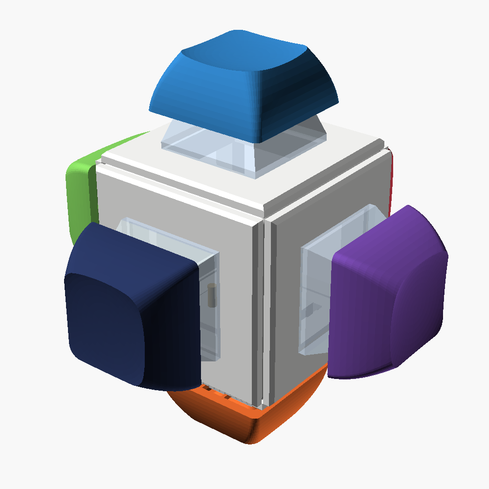
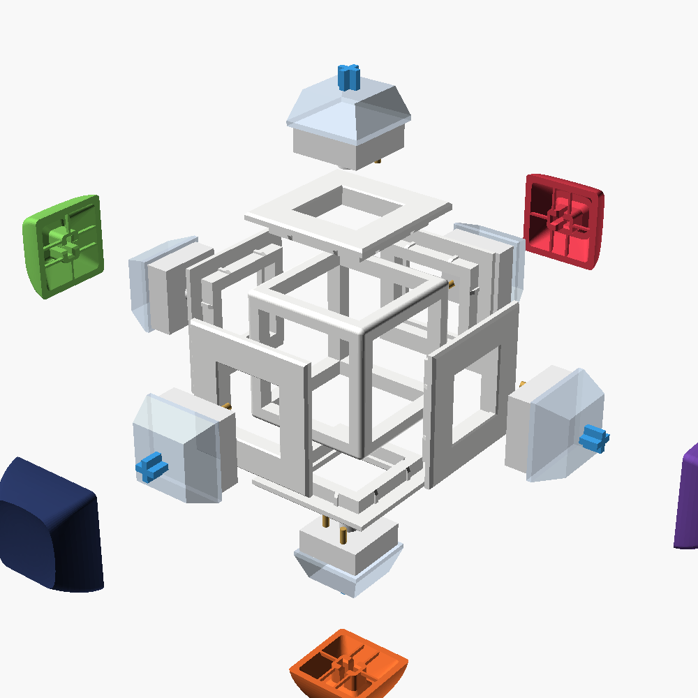
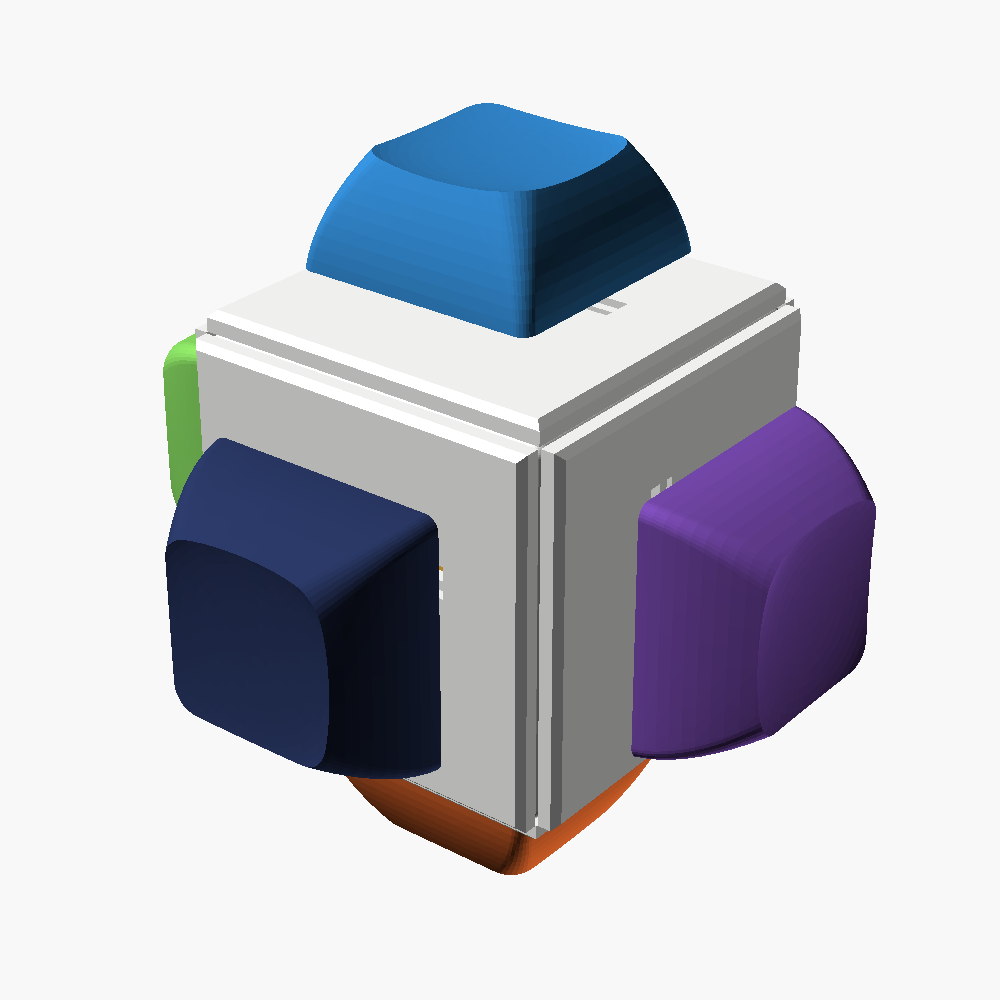
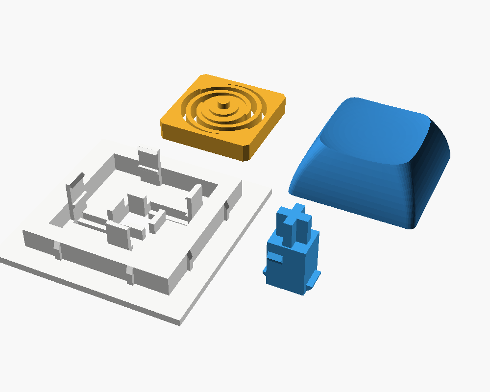
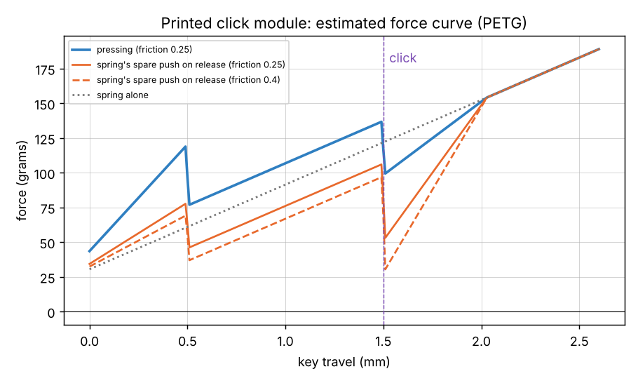

# Keyboard Switch Fidget Cube

A 30 mm cube with a clicky key on every face, purely as a fidget toy (no electronics). There are two ways to build it:

- **With real keyboard switches:** print the body and keycaps, then buy 6 switches (about $3.50 for 10). This is the proven option.
- **[Fully printed](#fully-printed-version-experimental):** every part comes off the printer, including the clicking mechanism. Nothing is bought and nothing is glued. This version is **experimental**: it's checked in software but hasn't been test-printed yet.

| Assembled | Exploded | Cut through the middle |
|---|---|---|
|  |  |  |

## Two versions of the body

| | One-piece cube | Frame + plates (style of the original) |
|---|---|---|
| Picture |  |  |
| Parts to print | `switch_cube_30mm_hole14.1.stl` ×1 | `frame_cube_frame.stl` ×1 + `frame_cube_plate_hole14.1.stl` ×6 |
| Filament / time* | ~12 g / ~1.5 h | ~13 g / ~1.5 h total |
| Good for | Simplest: one part, nothing to glue | All six switch holes print flat (most accurate); plates swap out |

\*PrusaSlicer generic profile with supports off, which is slow; a modern printer is quicker.

**Frame + plates assembly:** push a switch into each plate on a table, then press each plate into a frame window. The ring on the back of the plate goes inside, and its small crush ribs give a snug press fit.
If a plate is loose, put a drop of super glue on the ring. If it's too tight, sand the ribs. The frame and every plate print flat with no supports.
To tune the press fit, print the frame and one plate first.



## Fully printed version (experimental)

Everything is printed: the frame, plus four parts for each of the six faces. Nothing is bought, glued or made of metal.

| Your cube with printed "switches" | The 4 printed parts for one face (as they sit on the bed) |
|---|---|
|  |  |

**How it clicks.** Each face plate has two thin flexible fins cut into it.
The plunger (blue) carries the keycap and has two small teeth that push the fins aside as you press.
At about 1.5 mm the teeth slip past and the fins snap back: that's the click.
A flat spiral spring (orange) pushes the key back up, and the keycap landing on the plate is the bottom-out "clack".

**What's checked, and what isn't.** All of these come from `tools/check_click.py`:

- **Clearances:** over the whole press, the plunger only ever touches the fins.
- **No collisions:** the six modules never hit each other or the frame, in any rotation.
- **Spring:** a beam model sized it like the printed PETG springs that survived 200k+ presses in James Stanley's switch (peak strain about 2%).
- **Return:** the force curve below shows the spring always beats the fins on the way back up, even with high friction, so keys shouldn't stick.

The real feel depends on your printer and filament. **Print one face first and test it** before printing all six.



Expect it to feel heavier than a keyboard switch: about 190 g at the bottom versus about 60 g for a blue switch.
The click is plastic snapping, so it's probably quieter than a real blue switch.

### What to print

| Part | Qty | Material | Notes |
|---|---|---|---|
| `frame_cube_frame.stl` | 1 | PLA or PETG | Same frame as the frame + plates version |
| `click_plate.stl` | 6 | **PETG** | Print as is (outer face down), no supports. The fins and spring flex, and PETG survives that far better than PLA. |
| `click_spring.stl` | 6 | **PETG** | Print flat, as is |
| `click_plunger.stl` | 6 | PLA or PETG | Print standing up, as is. Use a brim if it falls over. |
| `keycap_dsa_fit*.stl` | 6 | PLA or PETG | Printed stem into a printed cap: start with `fit0.3` and `fit0.4` |

About 28 g of filament in total.
Use 0.15 mm layers, because the teeth and fins are small. Use 3 walls and 20–25% infill, and turn on elephant's foot compensation.

### Steps

1. **Print a test set:** 1 plate, 1 plunger, 1 spring, and keycaps `fit0.3` + `fit0.4`.
   Before assembling, flick each fin with a fingernail. It must wiggle freely. If the first layer fused it, run a knife through the gap.
2. **Plunger:** from the **back** of the plate, push the plunger in "+" end first until its little ears stop against the guides.
   It will click past the fins on the way. It only fits one way round; if it jams, turn it 90°.
3. **Spring:** turn the plate face down. Put the spring on the back, **pin and boss facing the plate**, so the pin goes into the hole in the plunger.
   Press the spring down between the four posts until it snaps under their hooks.
4. **Test:** press the "+" stem. It should click at about half travel and spring back.
   Don't press it all the way without a keycap; the keycap is the stop.
5. **Tune if needed** (see below), then print the other five sets.
6. Press each module into a frame window, the same way as the frame + plates version, then push on the keycaps.

### Tuning

| Problem | Fix |
|---|---|
| Key stays down, or comes back slowly | Use `click_plate_soft.stl` (thinner fins). Rubbing pencil graphite on the teeth also helps. |
| Key feels too heavy | Use `click_spring_light.stl`, ideally together with the soft plate |
| Fins don't move, or the click feels mushy | Fins are fused or too tight: clean the gaps. Check that your elephant's foot isn't filling them. |
| Keycap loose or too tight on the printed stem | Use another `keycap_dsa_fit*` number |

Every combination of these two plates and two springs passes the return check.
A stronger fin than the default (0.8 mm) fails it, so the default is the strongest click that still returns reliably.
To change anything, edit the knobs at the top of `cad/click_module.scad` and re-run `tools/check_click.py`.

## Is it possible?

Yes. It's a well-known maker project, and plenty of people have printed one (see [Prior art](#prior-art)).
The only tricky parts are:

1. **The switch holes have to be the right size.** MX switches need a 14.0 mm square hole in a 1.5 mm thick plate.
   Printers make holes slightly differently, so print the small fit-test piece first (see [Printing](#printing)).
2. **The switches have to fit together inside.** Six switches point at the centre, and their pins can hit each other in a small cube.
   That's why some small commercial cubes tell you to cut off pegs and bend pins.
   This design is 30 mm, and a script checks every switch rotation for collisions. Nothing needs trimming (see [Why 30 mm](#why-30-mm)).

## What you need

| Part | Qty | Print or buy? | Notes |
|---|---|---|---|
| Cube body | 1 | **Print** | Either version above |
| Keycaps | 6 | **Print** (or reuse/buy) | `stl/keycap_dsa_fit*.stl`, see [Keycaps](#keycaps). Any bought 1u MX keycap also fits. |
| MX-style mechanical switches | 6 | **Buy** (or reuse) | Any plate-mount MX-compatible switch: Cherry MX, Gateron, Kailh BOX, Outemu, Akko, etc. 3-pin and 5-pin both work as they are. The switches in your photos (clear housing, light-blue box stem) look like **Kailh BOX Pale Blue**, a clicky switch. About $3.50 for 10. |
| Keycap + switch puller | 1 | Buy (optional) | About $2–14. Only needed to take it apart again. |
| Filament | ~22 g | | PLA or PETG: about 12–13 g for the body, about 1.5 g per keycap |

**Not compatible:** low-profile Kailh Choc and Gateron LP switches and keycaps, Alps/Matias switches, and Topre. They use different holes and stems.

## Files

| File | What it is |
|---|---|
| `stl/switch_fit_test.stl` | Print this first: a plate and an upright wall with 13.9 / 14.0 / 14.1 / 14.2 mm holes |
| `stl/switch_cube_30mm_hole14.1.stl` | **The one-piece cube, default hole size.** Print this one if you skip the fit test. |
| `stl/switch_cube_30mm_hole13.9.stl` … `hole14.2.stl` | The same cube in the other hole sizes, to match your fit-test result |
| `stl/frame_cube_frame.stl` + `stl/frame_cube_plate_hole*.stl` | Frame + plates version: 1 frame, 6 plates in the hole size you picked |
| `stl/keycap_dsa_fit0.1.stl` … `fit0.4.stl` | Printable DSA keycaps; the number is the extra clearance (mm) in the "+" hole that grips the switch |
| `stl/click_plate.stl`, `click_plunger.stl`, `click_spring.stl` | Fully printed version: one printed "switch" per face (print 6 of each) |
| `stl/click_plate_soft.stl`, `click_spring_light.stl` | Tuning variants for the fully printed version |
| `cad/switch_cube.scad` | Parametric OpenSCAD source (size, hole, lip, pockets) |
| `cad/frame_cube.scad` | Parametric source for the frame + plates version (bar size, press-fit gap, crush ribs) |
| `cad/keycap.scad` | Keycap source: profile, "+" hole clearance, optional legend. Uses KeyV2 from `cad/lib/KeyV2`. |
| `cad/click_module.scad` | Source for the fully printed click module, with the click tuning knobs at the top |
| `cad/preview.scad` | Stand-in switches plus the printed keycaps, used for the pictures |
| `tools/check_fit.py` | Collision check: switches vs. the cube and vs. each other, in every rotation |
| `tools/check_click.py` | Checks for the printed click module: part clearances over the whole press, collisions between faces, and the force curve |
| `tools/spring_fe.py` | Beam model of the printed spiral spring (stiffness and strain) |
| `tools/build.sh` | Rebuilds all STLs and images and runs the check |

## Printing

**Step 1: fit test (strongly recommended).**
Print `stl/switch_fit_test.stl` in the same filament and settings you'll use for the cube.
Push a switch into each hole from the side with the labels or chamfer:

- the **flat row** behaves like the top and bottom faces of the cube,
- the **upright wall** behaves like the four side faces.

Pick the size where the switch goes in with a firm push, **clicks**, and doesn't wobble.
If two sizes feel equally good, take the larger one. Print the cube STL with that hole size.

**Step 2: the cube.**

| Setting | Value |
|---|---|
| Orientation | Any face down (it's symmetric) |
| Supports | **Off.** Everything facing down is a short bridge (≤ 16 mm) or a ledge under 1 mm. |
| Layer height | 0.2 mm is fine. 0.15 or 0.1 mm makes the 1.5 mm clip lips exact; at 0.2 they come out 1.4–1.6 mm, which still holds. |
| Walls / infill | 3 walls, 15–20 % infill |
| Elephant's foot compensation | On, if your slicer has it, so the hole on the bottom face isn't tight |
| Brim | Not needed |

PrusaSlicer's generic profile with supports off gives about **12 g** and 1.5 h. That profile is slow; a modern printer is quicker.

## Keycaps

The keycaps come from **[KeyV2](https://github.com/rsheldiii/KeyV2)**, a widely used open-source keycap generator (GPL-3.0).
They're DSA profile: short, and the same on every face.

The stem is the part that has to fit, and it varies by printer. So print the **four test caps first**: `keycap_dsa_fit0.1`, `0.2`, `0.3` and `0.4`. The number is extra clearance in the "+" hole; 0.2 is KeyV2's default.
Press each onto a switch. Keep the one that goes on firmly and doesn't fall off when you shake it, then print the rest at that size.
In general, a bigger number means a looser cap.

- **Orientation:** upright, the open side on the bed, exactly as the STL is.
- **Supports:** don't add any. The thin "tines" under the stem are KeyV2's built-in support. Snap or cut them off after printing.
- **Layer height:** 0.12–0.16 mm makes a nicer top. **PETG** stems are tougher than PLA.
- **Elephant's foot:** turn on compensation. KeyV2's author says a squished first layer causes most stems that don't fit.
- **Size:** about 1.5 g each.

Want letters or symbols? Set `legend_text` in `cad/keycap.scad` to engrave one. You can also pick another profile (`cherry`, `oem`, `sa`, `dcs`, `g20`).

## Can the switches be printed too?

**Not reliably yet**, so this repo doesn't include printed switches. Here is what's out there; the evidence below comes from the projects' own pages and comments, as of October 2026:

| Design | Clicks? | Tested? | Notes |
|---|---|---|---|
| [Dummy Keyboard Switch (MX key) – enemyzero](https://makerworld.com/models/1984011) | No, linear or tactile | **Yes**, about 17k prints, 4.5★ | One-piece print, PETG recommended. The author says it's not fully MX-compatible. |
| [Print-A-Click V2 – Terrentec](https://makerworld.com/models/2983145) | **Yes**, claimed | Barely: 5 ratings | PETG required. It was designed for a 15.6 mm switch pocket; whether it clips into a 14 mm plate is unknown. |
| [James Stanley's printed switch](https://incoherency.co.uk/blog/stories/3pct-keyboard.html) | No | Yes: 200k+ presses on a test rig | Its plunger isn't an MX cross, so normal keycaps don't fit |
| [Riskable Void Switch](https://github.com/riskable/void_switch) | No, tactile | Used daily by its author | Needs 3 small magnets per switch; personal-use license |
| [Mechanical Switch Fidget Click – kriswillcode](https://www.printables.com/model/71100) | **Yes**, loud | 50 makes | A good printed click mechanism, but it's a 32 mm standalone toy (plus a pen spring), far too big for a cube face |

So nobody has a well-tested printed switch that **both clicks and fits a normal 14 mm plate with MX keycaps**.
That's why this repo has its own design: see [Fully printed version](#fully-printed-version-experimental).
It borrows the ideas that *are* proven: thick, narrow PETG spiral springs like Stanley's, and a snap-past click like the printed fidget clickers.
If you want the proven route instead, real switches are cheap (about $3.50 for 10), and you already have six.

The MakerWorld designs above are free to download for personal use. They aren't openly licensed, so they can't be copied into this repo.

## Assembly

1. Check every hole is clean: no strings, no blobs, and no squished first layer on the bottom face (trim it with a knife).
2. Push a switch **straight** into a hole from outside until both clips snap. Pressing it against a table helps.
   Any rotation works.
3. Repeat for all six faces.
4. Press a keycap onto each stem.

To take a switch out, squeeze its two clips with a switch puller from the outside and pull.
To remove a keycap without pulling the switch out, use a keycap puller.

**Troubleshooting**

- *Switch won't go in:* use the next larger hole size, or file the hole lightly. Also check for elephant's foot.
- *Switch wobbles or pops out:* use a smaller hole size. Or the lip printed thin: reprint at 0.15 mm layers.
- *A switch feels gritty:* it's being squeezed. Use a larger hole size.
- *Printed keycap won't go on, or cracks:* use a bigger fit number. *Falls off:* use a smaller one.

## How it works

Each face has:

- a **14.1 mm hole in a 1.5 mm lip**; the switch's clips snap under it (MX plate spec: 14.0 mm, 1.5 mm),
- a **15.8 mm pocket** under the lip, so the clips can spring open,
- a **13 mm pocket** behind that, for the pins, centre post and the optional 5-pin pegs.

In the one-piece cube the middle is hollow. Its pocket ceilings are short bridges and the steps between pockets are 45°, so it prints without supports.
The frame version builds the same geometry from a skeleton frame plus six flat plates.

### Why 30 mm

`tools/check_fit.py` places a simplified MX switch on every face, in all four rotations and with both pin layouts, and tests it against the cube and the other switches.
The switch has clips, 3.5 mm pins, the centre post and the 5-pin pegs. It also tests the keycaps at full press.

| Cube size | Result |
|---|---|
| 26 mm | 120 of 240 switch/rotation pairs collide (neighbouring switches' pins and pegs hit each other) |
| 28 mm | 72 of 240 still collide, by smaller amounts |
| 29 mm | OK, small margin |
| **30 mm** | **OK, about 0.5 mm margin in every combination** |

So any MX switch fits in any rotation at 30 mm. Your cube looks a bit smaller than that, which works only with the right switch rotations or trimmed pins.

## Customising

Open the `.scad` files in [OpenSCAD](https://openscad.org) and use the Customizer panel.
The keycaps and `tools/build.sh` need a **recent OpenSCAD** (2025 or a nightly build); the older 2021.01 can't run KeyV2.
First fetch KeyV2 with `git submodule update --init`. Then, for example:

```sh
openscad -o my_cube.stl -D 'part="cube"' -D cube_size=30 -D hole_size=14.05 cad/switch_cube.scad
openscad -o my_cap.stl -D cross_slop=0.2 -D 'legend_text="A"' cad/keycap.scad
python3 tools/check_fit.py my_cube.stl 30      # needs: pip install trimesh manifold3d
```

`tools/build.sh` regenerates everything (`SIZE=32 tools/build.sh` for a bigger cube).

## Prior art

Other published versions of this idea, for comparison. None of their files are used here; the cube was written from scratch.

- [MX Fidget Cube – judy2k](https://www.thingiverse.com/thing:3622010): one piece, printed standing on a corner with a brim
- [Mechanical Keyboard Switch Fidget Cube – Unboxious](https://www.thingiverse.com/thing:4027401): needs tree supports, and 5-pin pegs cut off
- [Fidgekey – jumar](https://www.thingiverse.com/thing:4596249): 6- and 24-switch versions
- [Fidget Cube, 6× switches – onebigdoor](https://www.thingiverse.com/thing:4703545): one piece or two halves
- [Fidget Cube for keyboard switches – PrintsThatScale](https://makerworld.com/en/models/1183392)
- [Mechanical Switch Fidget Cube – scuzzy19](https://makerworld.com/en/models/422104)
- Commercial: Thock King Fidget Cube (resin shell); its mini version requires cutting pegs and bending pins

The keycaps are generated with [KeyV2](https://github.com/rsheldiii/KeyV2) by rsheldiii (GPL-3.0).
Switch dimensions come from the [Cherry MX datasheet](https://cdn.sparkfun.com/datasheets/Components/Switches/MX%20Series.pdf).
The pocket idea is the usual printed-plate approach, as in [Riskable's MX cutout](https://www.thingiverse.com/thing:4120804).

> Not physically test-printed yet. The geometry is checked in software, and the fit-test pieces (holes and keycap stems) are there to absorb printer-to-printer differences.
